# LIFT3 SDK

**English** | [简体中文](README.zh-CN.md)

LIFT3 consists of a mobile platform and X5 arms. This document covers the **mobile platform** only; for the X5 arms, see the [ARX5 SDK documentation](https://github.com/ARXroboticsX/ARX5_beta/blob/main/readme.md).

> **⚠️ Safety**
>
> - Make sure the robot is mounted securely, and keep a 2 m radius around the base clear. Watch out for fragile objects and people nearby.
> - In an emergency, cut the power first.

## Contents

- [Requirements](#requirements)
- [Hardware](#hardware)
- [Emergency stop](#emergency-stop)
- [CAN configuration](#can-configuration)
- [Platform SDK](#platform-sdk)
- [Remote control](#remote-control)

## Requirements

- Ubuntu 24.04
- Python 3.12 (the Ubuntu 24.04 system Python; `liftlib` ships as compiled modules for this version only)
- Environment setup is the same as for X5 — see the [ARX5 SDK documentation](https://github.com/ARXroboticsX/ARX5_beta/blob/main/readme.md).

## Hardware

### Cabling

- **No GPU needed**: control the robot from the onboard NUC.
- **GPU needed**: connect the sensors and signal cables to your own PC instead.

The wiring is the same in both cases:

<p align="center">
  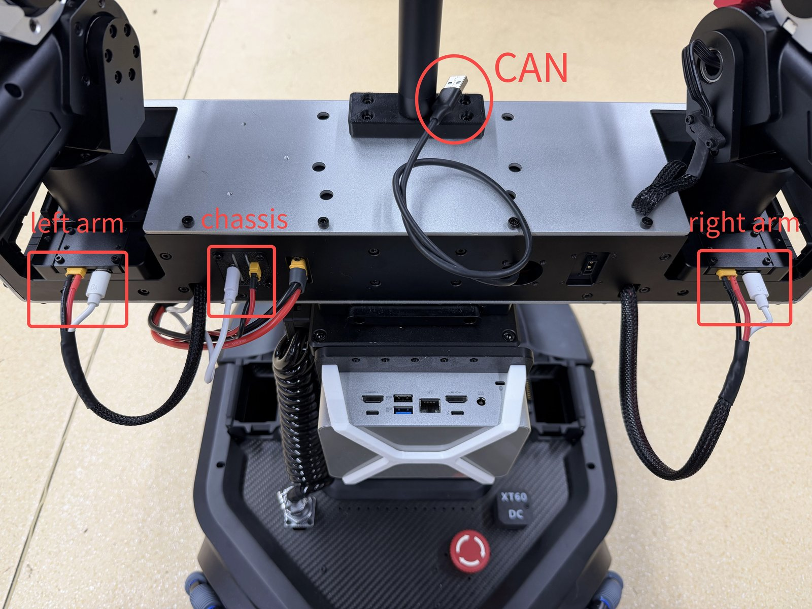
</p>

Connect the **left arm**, **right arm** and **chassis** cables to the robot. The CAN signals are merged internally, so you only need to plug the CAN USB cable into your computer.

> **Note:** Give the CAN USB cable a USB port of its own — do not share it with other devices, to avoid signal interference.

### Power

> **Note:** Battery packs are not included by default; out of the box the robot is powered by cable only.

<p align="center">
  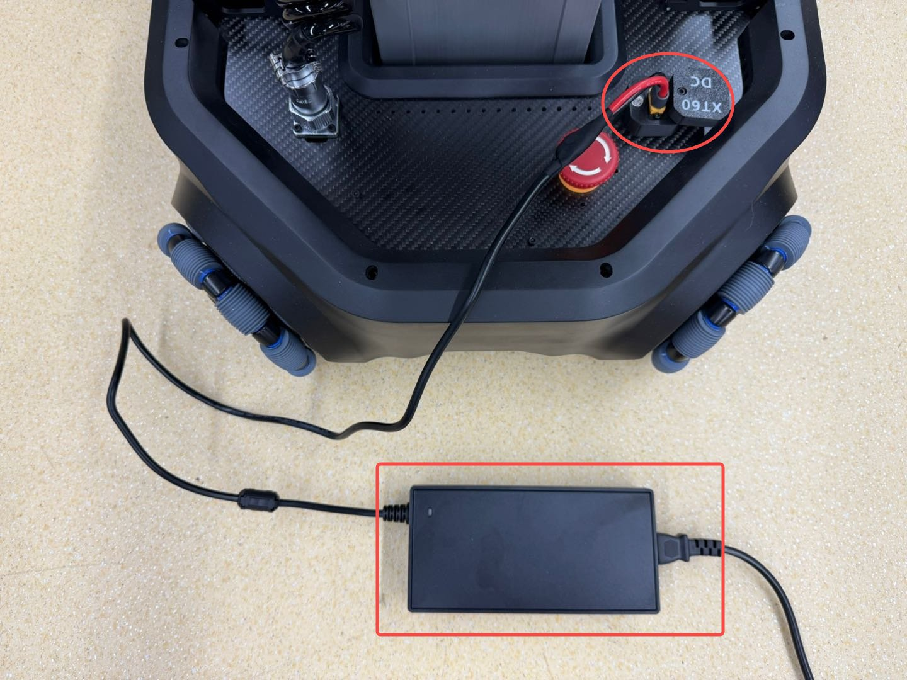
</p>

### Battery packs

The robot uses two battery packs, which can be hot-swapped for quick replacement.

To power on, short-press the battery power button once, then press and hold until all four LEDs light up.

<p align="center">
  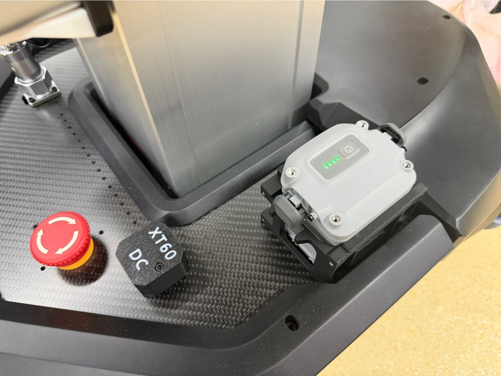
</p>

Removing and installing a battery:

<p align="center">
  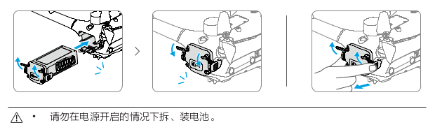
</p>

Charging hub:

<p align="center">
  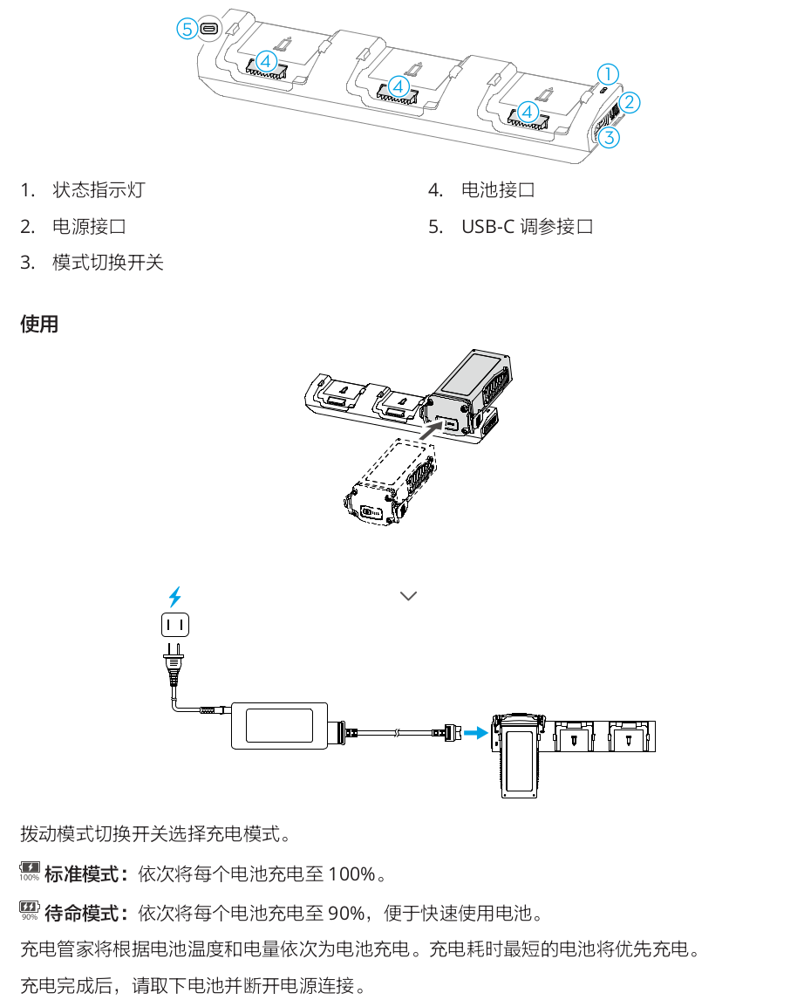
</p>

1. Status LED
2. Power port
3. Mode switch
4. Battery port
5. USB-C configuration port

Use the mode switch to select the charging mode:

- **Standard mode**: charges each battery to 100%, one after another.
- **Standby mode**: charges each battery to 90%, one after another, so batteries are ready to use sooner.

The hub charges batteries in order based on their temperature and charge level; the battery that needs the least time is charged first. When charging is complete, remove the batteries and disconnect the power.

## Emergency stop

- Twist to release the emergency stop **before** powering on.
- In an emergency, press the emergency stop with your foot or a tool. **The lift platform drops when power is cut** — keep clear.

<p align="center">
  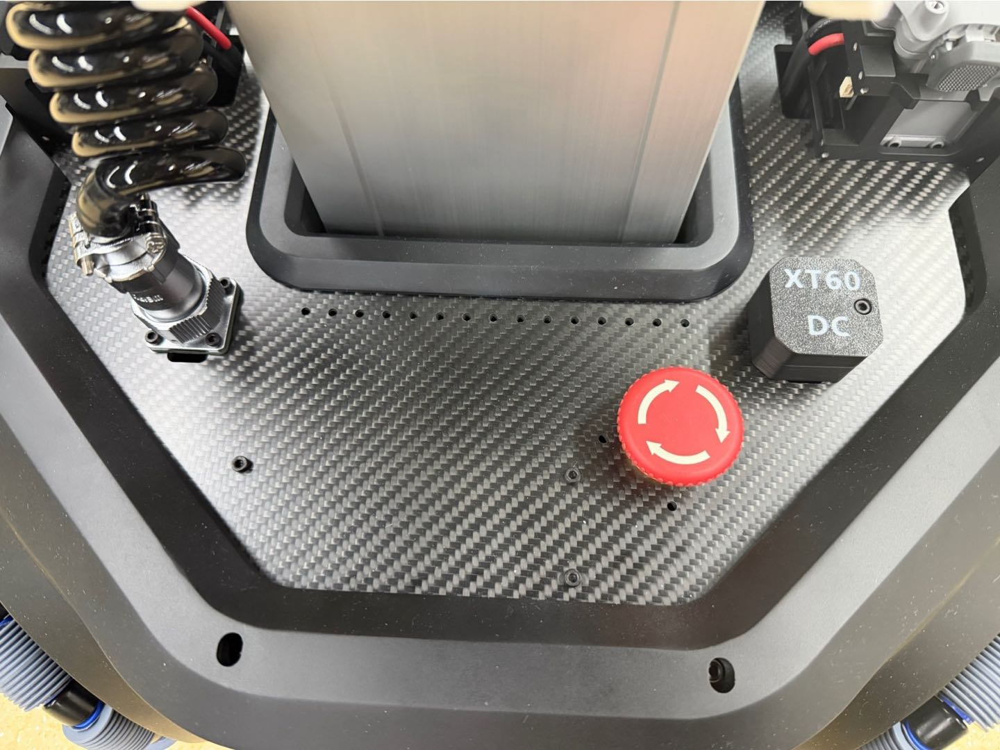
</p>

## CAN configuration

Double-click `LIFT-SDK/ARX_CAN_doctor` to launch it. The procedure is the same as for a single arm: only the device being configured should be connected.

| Device | CAN |
|---|---|
| Left arm | `can1` |
| Left leader arm | `can2` |
| Right arm | `can3` |
| Right leader arm | `can4` |
| Chassis | `can5` |
| Remote controller | `can6` |

1. **If you use the remote controller, connect it on its own first** and assign its channels 2, 4, 6 in order. The remote controller is the only device configured differently from a single arm or the chassis: it exposes three CAN channels at once.

   <p align="center">
     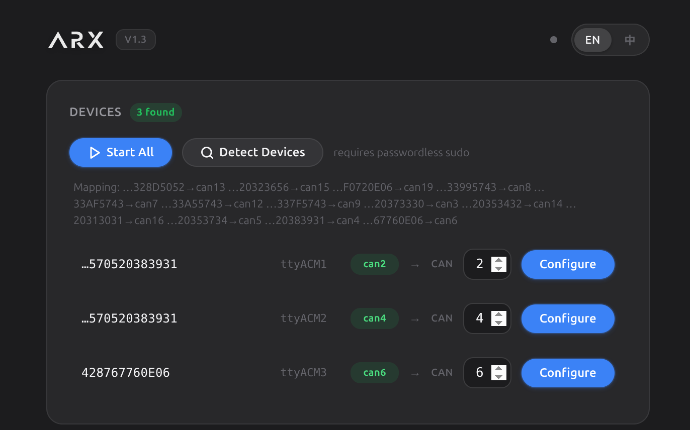
   </p>

2. Then plug in the remaining devices **one at a time** and assign each its ID. After configuring one device you can leave it plugged in and plug in the next — connecting them one by one is only how you tell the devices apart.
3. Configuration only needs to be done once, unless devices are replaced.

## Platform SDK

### Example

From the `LIFT-SDK/` directory, run:

```bash
python3 demo_sdk.py
```

It uses `can5` by default; select the robot type `LIFT2026_18`:

```python
CAN_ROBOT = 'can5'  # robot CAN interface
ROBOT_TYPE = RobotType.LIFT2026_18  # X7 with head: X72026; LIFT without head: LIFT2026_18
```

> Call `robot.loop()` continuously in your control loop (~400 Hz), as in `demo_sdk.py`. If it is not called for more than 0.5 s, the robot brakes automatically.

### 1. Height control

```python
robot.set_height(set_lift_height)  # target height (m), range 0–0.38
```

### 2. Chassis velocity control (mode 1)

```python
robot.set_chassis_cmd(x, y, z, 1)  # x, y: m/s; z: rad/s; mode = 1
```

### 3. Wheel velocity control (mode 3)

```python
robot.set_chassis_cmd(0, 0, 0, 3)    # switch to mode 3
robot.set_wheel_vel(v1, v2, v3, v4)  # wheel velocities (rad/s), wheel IDs as shown below
```

<p align="center">
  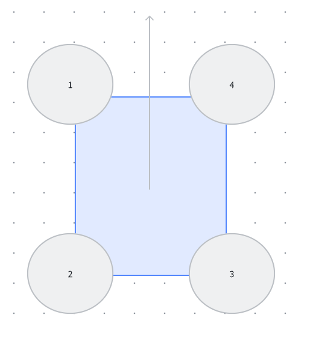
</p>

### 4. Head control

Angles in rad. **X7 only** — on LIFT models these calls do nothing.

```python
robot.set_head_yaw(0.2)
robot.set_head_pitch(-0.2)
```

### 5. State feedback

```python
print(f"Height: {robot.get_height()}")
print(f"Wheel velocity: {robot.get_wheel_vel()}")
print(f"Head angles: {robot.get_head_pos()}")  # [yaw, pitch]
```

## Remote control

### Hardware setup

1. Plug the cables of both leader arms into the remote controller.

   <p align="center">
     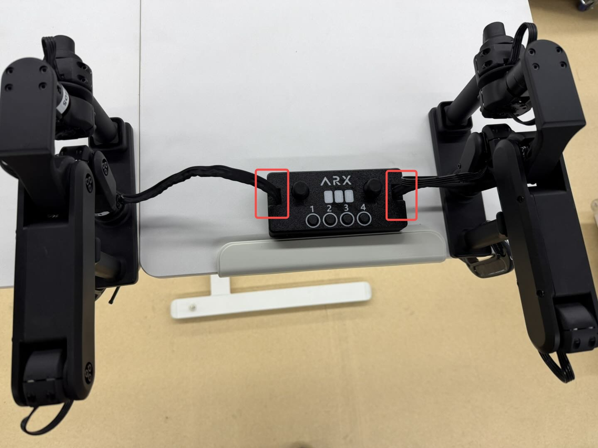
   </p>

2. Fix the leader arms to the table with the included G-clamps.

   <p align="center">
     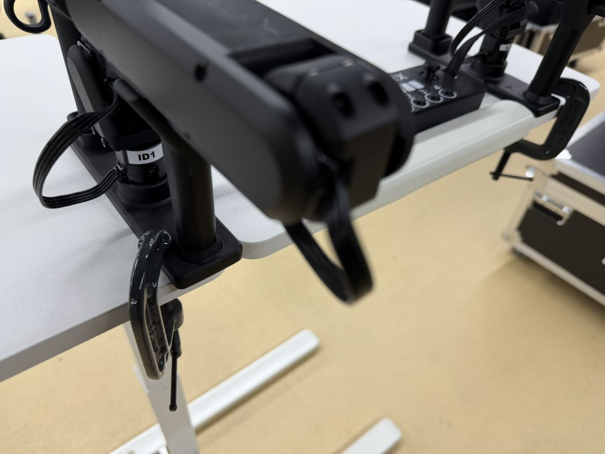
   </p>

3. Connect the remote controller to your computer with the included USB cable.

   <p align="center">
     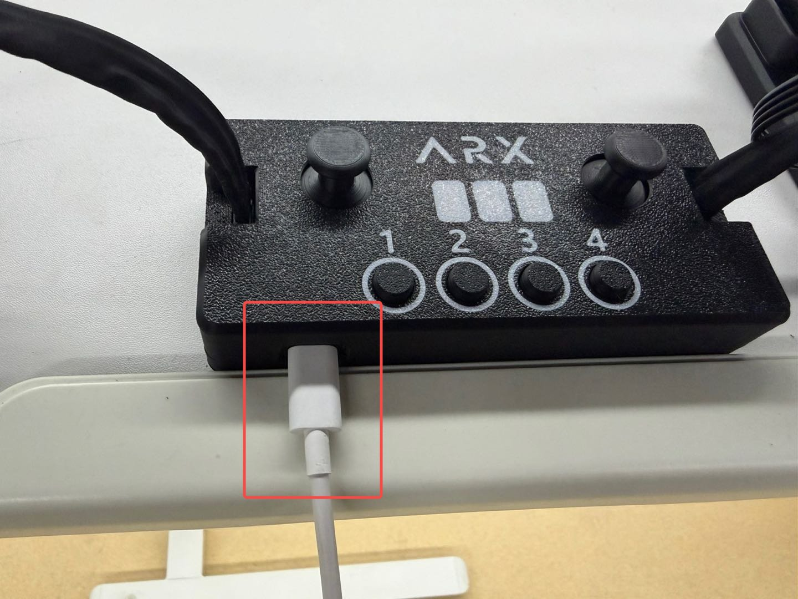
   </p>

### Running the demo

From the `LIFT-SDK/` directory, run:

```bash
python3 demo_joy.py
```

- **Left stick**: up/down sets the lift height, left/right rotates about the Z axis
- **Right stick**: moves in the x / y directions

<p align="center">
  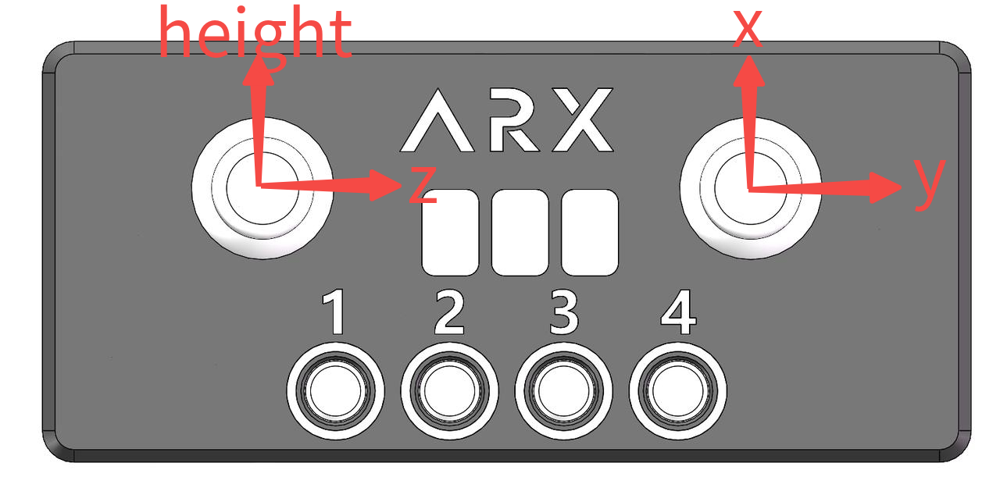
</p>
